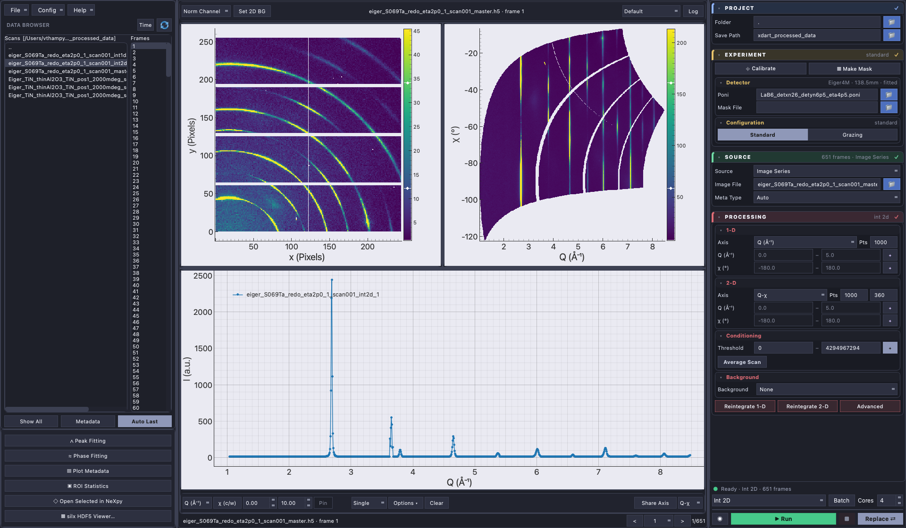
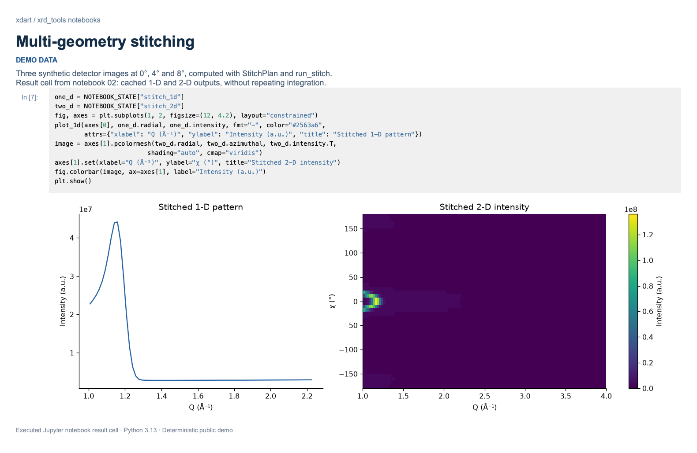
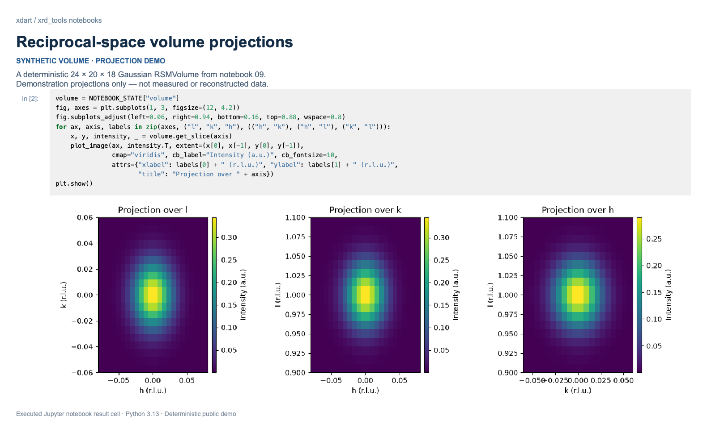

# xdart

**X-ray diffraction processing and analysis, from live acquisition to notebooks.**

xdart combines detector-image integration, multi-angle stitching,
reciprocal-space mapping (RSM), and fitting in one desktop application.
It uses [pyFAI](https://pyfai.readthedocs.io/) for azimuthal and grazing-incidence
integration and [xrayutilities](https://xrayutilities.sourceforge.io/) for
stitching and reciprocal-space mapping. The same processing tools are available
in Python through **`xrd_tools`**, the headless core included with xdart.

This README describes **xdart 1.2.3**.
[Release notes](RELEASE_NOTES.md) · [Upgrading from 1.1.5](MIGRATION.md#upgrading-from-115-to-120) ·
[Limitations and workarounds](docs/LIMITATIONS.md)



[Install](#quick-start) · [GUI workflow](#gui-quick-start) ·
[Stitch](#stitch-1d-and-stitch-2d) · [RSM](#reciprocal-space-mapping-rsm) ·
[Python and notebooks](#headless-quick-start-xrd_tools) · [Development](#development)

<a id="install"></a>

## Quick start

1. [Install Pixi](https://pixi.sh/latest/installation/) and open a new terminal.
   Python and conda do not need to be installed separately.
2. Install the **published release**:

   ```bash
   pixi global install -c https://prefix.dev/xrd-tools -c conda-forge xdart
   ```

3. Launch the xdart app/shortcut, or run `xdart` in a terminal.

To update a global installation, use **Help → Check for Updates…**: xdart closes, a window shows the
update, and xdart reopens showing the new version. xdart also checks when it starts and updates after a
10 s notice that offers **Not now**; **Help → Check for Updates at Startup** turns that off. You can also
close xdart and run `pixi global update xdart`.
To work from source, follow the [source-checkout setup](#development).
Global installation and source-checkout installation are separate environments.

Pixi and conda/mamba supply the compiled dependencies needed by the GUI.
Pip-only GUI installation is best-effort. See the
[installation guide](docs/INSTALLATION.md) for alternative installers,
headless Python environments, and troubleshooting.

## The GUI (`xdart`)

The Scattering Workspace combines processing controls, a data browser, plots,
and analysis tools. Select a processing mode beside **Run**:

| Mode | Result |
| --- | --- |
| **Int 1D** | Integrated 1D patterns in a processed NeXus file. |
| **Int 2D** | Integrated 1D patterns and 2D maps in a processed NeXus file. |
| **Int 1D (XYE)** | Individual text patterns with axis, intensity, and uncertainty. |
| **Stitch 1D / Stitch 2D** | A profile or map combining raw frames from multiple detector angles. |
| **RSM** | An HKL or Cartesian-Q volume, with planes, profiles, and 3D viewing. |
| **1D Viewer / 2D Viewer** | Browsing of supported patterns and detector images. |

Standard and grazing-incidence integration support masks, intensity thresholds,
background subtraction, normalization, and parallel processing. Analysis tools
include overlays, peak/phase fitting, reference phases, and notebook export.

### GUI quick start

1. Set the **Project folder** and **Save Path**. The default output folder is
   `<Project>/xdart_processed_data`.
2. Under **Experiment**, choose a matching PONI calibration and an optional
   mask. **Calibrate** and **Make Mask** open the corresponding tools.
3. Choose the source format and input files or directory. Check image paths,
   scan selection, and metadata as appropriate for your source.
4. Select **Int 1D**, **Int 2D**, or **Int 1D (XYE)**. Set axes, point counts,
   ranges, and conditioning. **Advanced** contains the detailed corrections.
5. Choose **Cores**, then **Run**. **Batch** suppresses intermediate plot
   updates and displays the saved result at completion.
6. Select saved results and frames in the **Data Browser**. Use **Raw image**,
   **Metadata**, and the fitting tools to inspect them.

For Q/2θ conversion, xdart uses the acquisition/calibration wavelength. For a
fixed scattering angle, Q changes with wavelength; 2θ is an angle.

For grazing incidence, choose **Experiment → Configuration → Grazing** and
set the incidence-angle motor or manual angle. GI offers Qip/Qoop profiles and
maps, Q–χ, and exit-angle modes. Choose **Q–χ + Qip–Qoop** when both directly
integrated maps are needed; the derived Q–χ display is only an approximation.

### Stitch 1D and Stitch 2D

Stitch combines **raw detector frames with scan-angle metadata**. Select
**Stitch 1D** or **Stitch 2D** beside Run.

1. Set the Project folder, output location, and source: **SPEC + Image Series**,
   **SPEC + Eiger**, or metadata-bearing **NeXus**. Choose **Files** or a
   **Folder**; folder discovery supports **Subdirs** and **Filter**.
   For SPEC, check **Image Path** and **Image Stem**. A blank stem uses
   `<SPEC name>_scan<N>_`. An Eiger master alone does not supply scan angles.
2. Select scans. **All** produces one output per scan; **Select** accepts
   groups, such as `1,2,[3-5,8]` for two separate outputs plus one combined
   output. Groups apply to each selected SPEC file. **Files + NeXus** combines
   the selected containers/entries; use **Entry** to restrict entries.
3. Select a calibration or create one with **Calibrate**. Choose
   **pyFAI MultiGeometry** or **xrayutilities histogram** as the backend.
   The shared calibration workflow saves a pyFAI goniometer calibration and
   its xrayutilities `.xu.json` partner. XU requires its own calibration or
   that partner; an arbitrary PONI is insufficient. pyFAI's advanced
   **PONI + offsets** route requires matching angle mappings and reference angles.
4. Choose **Standard** or **Grazing**, then configure ranges, point counts,
   **Normalize**, **Threshold**, and **Mask File**. GI incidence/tilt may come
   from metadata motors or manual angles.
5. Optionally use **Preview** to check membership and warnings, then **Run**.
   Run validates the inputs even without Preview.
6. Open the saved `_stitch1d.nexus` or `_stitch2d.nexus` result. **Full** shows
   the combined result; contributor rows inspect its source frames.
   **Append** skips compatible completed outputs; **Replace/Overwrite**
   recomputes them.

For fitting, return to **Full** and select **Intensity**. Phase fitting needs
an appropriate radial Q/2θ profile and wavelength; GI cuts support peak fits.
Keep calibration, camera orientation, and recorded motor conventions consistent.

### Reciprocal-space mapping (RSM)

RSM grids raw frames and their recorded motor positions into a volume.
It is a finite workflow with **Preview**, **Run**, and **Stop**.

1. Choose the source and scan groups as for Stitch. `42,43` produces separate
   maps; `[42-44]` combines those scans.
2. Select or create a calibration. RSM currently requires **six-circle PSIC
   geometry** and the calibration's `.xu.json` partner within the Project.
   Single-2θ, four-circle, and two-circle partners are not supported.
3. Leave **Use the calibration's refinement** enabled to apply detector-angle
   zero offsets, mount refinement, and the fitted energy correction:
   `scan energy + (fitted calibration energy − recorded calibration energy)`.
   Distance and beam centre are used even when this option is disabled.
   The calibrant's fitted sample displacement is not transferred to the sample.
4. Choose **HKL** or **Q Cartesian (Qx, Qy, Qz; Å⁻¹)**. HKL also needs a UB
   matrix from the source, typed values, or a SPEC scan. **Advanced → Angle
   mapping** maps metadata to `mu, eta, chi, phi, nu, del`.
5. Set the grid counts, initially `40 × 40 × 40`, plus normalization,
   thresholds, masks, and corrections. Bounds come from the selected data;
   each count must be at least two, with at most 8,000,000 voxels in total.
6. **Preview**, then **Run**. Outputs normally end in `_rsm.nexus`.
   **Append** skips unchanged completed results; **Replace/Overwrite**
   recomputes them. **Stop** cancels the current calculation and remaining queue.
7. Inspect the saved map's three planes and profiles, **3D Viewer**, or
   **Custom Slice**. Tools provide lineout, 2D, and 3D peak fits. Display Log
   and background controls do not rewrite the scientific fit inputs.

Opening a saved result does not rerun the calculation or restore a complete
processing setup. Preserve raw data and calibration for processing replay.

### Calibration and masking

For Int modes, **Calibrate** opens pyFAI calibration to produce a PONI file.
For Stitch/RSM, the shared calibration dialog supports direct-beam distance
fitting, calibrant frames, and **Quick calibration** with a resumable session.
The calibrant scan's energy field represents acquisition energy; the fitted
energy correction is retained separately. Imported beam coordinates remain
geometry values unless explicitly edited as a direct-beam scan locator.

Use a calibration appropriate to the detector, image dimensions, and camera
orientation. A mismatched calibration or mask can prevent integration; failed
runs display the reason.

**Mask File** accepts `.edf` or `.npy`. **Make Mask** saves beside the source as
`<source-stem>-mask.edf` and selects it automatically; an existing mask at that
path is replaced. Closing without saving keeps the previous selection.
**Threshold** applies per-frame intensity limits independently of the mask;
turning it off does not disable the mask or make nonfinite pixels valid.

For headless direct-beam fitting, see the [API guide](docs/core/direct_beam.md)
and [distance-calibration notebook](examples/direct_beam_distance_calibration.ipynb).

### Live acquisition and output handling

For supported Int 1D/2D sources, enable **Live** to process new arrivals.
**Run** becomes **Pause / Resume**; **Stop** ends the run and closes its output.

- **Append** continues a compatible processed NeXus scan, skipping frames
  already present. **Replace/Overwrite** reprocesses it. Int 1D (XYE) does not
  support Append. Stitch/RSM Append skips complete results, as described above.
- **Single** follows the current selection; **Overlay** keeps patterns for
  comparison. Pin a slice cut with **Cmd+P** (**Ctrl+P** on Windows/Linux).
- Processed NeXus results retain integrated data, metadata, and thumbnails.
  Keep the referenced raw images for full-resolution inspection and set the
  Project folder after moving a project.
- The browser can also open files in **NeXpy** or **silx view**, included with
  the GUI installation.

### Data export and saving

Int and Stitch save processed NeXus results; Int 1D (XYE) writes text patterns.
Stitch also saves an XYE profile companion. GI Stitch's saved Qip/Qoop cuts have
XYE companions whose third column is `sqrt(abs(I))`, an estimate rather than
propagated uncertainty, as their headers state.

Use a plot's export menu for additional cuts or PNG/SVG figures. Fitting tools
provide CSV, **Export Jupyter…**, and **Export marimo…**.
**Help → Export Run notebook…** exports current processing inputs for replay;
**Help → Export Analyze Results Notebook…** exports a notebook that reads saved
results without rerunning integration. These notebooks reference data files;
exporting does not copy those files.

## Headless quick start (`xrd_tools`)

`xrd_tools` provides integration, stitching, RSM, NeXus I/O, peak/phase fitting,
and strain analysis without the desktop GUI. For example, integrate an image
with an existing PONI calibration:

```python
from xrd_tools.io import read_image
from xrd_tools.integrate import load_poni, poni_to_integrator, integrate_1d

ai = poni_to_integrator(load_poni("calibration.poni"))
image = read_image("detector.tif")
result = integrate_1d(image, ai, npt=1000, unit="q_A^-1")
q, intensity, sigma = result.radial, result.intensity, result.sigma
```

To write complete processed scans, use `ReductionPlan`, `Scan`, `NexusSink`,
and `run_reduction`, as shown in the
[headless reduction notebook](examples/notebooks/06_headless_reduction_pipeline.ipynb).
The [processed-data notebook](examples/notebooks/07_reading_processed_nxs.ipynb)
covers reading saved results, thumbnails, and original raw frames.

<a id="pixi-notebook-kernel"></a>

### Notebooks

The GUI installation includes JupyterLab, marimo, and notebook widgets:

```bash
xdart-notebook                         # JupyterLab in the installed environment
xdart-notebook --register-kernel       # Register "Python (xdart)" for VS Code
xdart-notebook --marimo results.py     # Open an exported marimo notebook
```

In an editable Pixi checkout, use `pixi run --locked xdart-notebook` instead.
Select the corresponding Python kernel and **Run All**. See
[notebook setup](docs/INSTALLATION.md#jupyter-and-vs-code-kernel-setup) for
kernel registration, widgets, and missing-kernel troubleshooting.

The [notebook gallery](examples/notebooks/README.md) covers batch integration,
GI, stitching, RSM, peak/phase fitting, strain, and time-resolved analysis.
Examples default to deterministic demonstration data and need no private data.





## Development

Use the shared Pixi workspace for an editable source installation:

```bash
git clone https://github.com/v-thampy/xdart.git
cd xdart
pixi install --locked
pixi run --locked xdart
```

The default `main` branch contains the current source. To use the exact 1.2.3
release, run `git switch --detach v1.2.3` before installing.
The lockfile covers Apple Silicon macOS, Linux x86-64, and Windows x86-64.
Each machine installs its own environment; keep the shared lockfile unchanged
when testing on another machine.

To update an existing checkout after saving or committing local work:

```bash
git pull --ff-only
pixi install --locked
pixi run --locked xdart
```

Source edits take effect after restarting xdart. See the
[editable setup guide](docs/INSTALLATION.md#editable-install-with-pixi-recommended),
[Windows instructions](docs/INSTALLATION.md#windows-fresh-editable-install),
and [test and packaging commands](docs/INSTALLATION.md#tests-and-packaging).

## Limitations and troubleshooting

Read [limitations and workarounds](docs/LIMITATIONS.md) before upgrading or
reusing older output. In particular, older Standard seam-window results need
full regeneration with **Replace/Overwrite**, and full-turn I(χ)/cake ranges
should use **Auto**. Derived GI Q–χ displays are approximate and do not replace
directly integrated maps for quantitative analysis.

If a run fails, check its displayed reason and terminal log. Check calibration,
image/mask dimensions, source metadata, and output access before retrying.
For high memory use, reduce **Cores**; the memory planning target is advisory.
Avoid modifying or synchronizing output files while xdart is writing them.
Installation and notebook troubleshooting are in the [installation guide](docs/INSTALLATION.md).
Native Windows/SMB and GUI behavior still require release qualification;
a passing offscreen test does not establish native behavior.

## Contributing

Bug reports and contributions are welcome through
[GitHub issues](https://github.com/v-thampy/xdart/issues) and pull requests.
Include the xdart version, operating system, steps to reproduce, and error
message when reporting a problem.

## License and citation

First-party code is [MIT licensed](LICENSE); portions of the headless core
retain their [BSD-3-Clause license](licenses/LICENSE-ssrl_xrd_tools).
SPDX: `MIT AND BSD-3-Clause`.

If you use xdart in research, cite the project and the underlying scientific
packages used in your analysis:

> xdart: SSRL X-ray diffraction toolkit. https://github.com/v-thampy/xdart

## Acknowledgments and contact

Developed at the [Stanford Synchrotron Radiation Lightsource (SSRL)](https://www-ssrl.slac.stanford.edu/),
SLAC National Accelerator Laboratory, by **Vivek Thampy** — vthampy@stanford.edu.

Thanks to the authors and contributors of pyFAI (including its FiberIntegrator),
xrayutilities, [NeXpy](https://nexpy.github.io/nexpy/),
[silx](https://silx.readthedocs.io/en/stable/), NumPy, SciPy, lmfit, and pymatgen,
and to the users who provide feedback and improvements.
